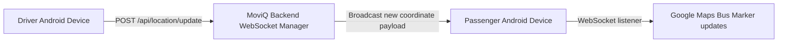

# MoviQ Transit — Real-Time Public Bus Transportation Platform

MoviQ Transit is a complete, real‑time public bus transportation solution consisting of two Android applications and a shared backend:

- **Passenger App (`moviq-passenger`)**: Search bus journeys, compare fares and schedules, track live buses on Google Maps with real‑time driver GPS, and view stop‑progression timelines.
- **Driver App (`moviq-driver`)**: Authenticate driver shifts, verify pre‑trip vehicle checks, automatically collect and transmit device GPS coordinates via a foreground service, and manage active trip status.
- **Shared Backend (`moviq-backend`)**: FastAPI REST and WebSocket server for route queries, active‑trip lifecycle, location ingestion, and real‑time WebSocket coordinate streaming.

---

## 🎨 Implemented UI Screens

The platform implements a polished 6‑screen design system:

| # | Screen | App | Description |
|---|---|---|---|
| **01** | **Home & Search** | Passenger | Origin/destination inputs, swap action, time controls, search button, recent searches, nearby stops. |
| **02** | **Search Results** | Passenger | Journey list with sorting (fastest, cheapest, fewest transfers), departure/arrival times, fare display. |
| **03** | **Live Bus & Map** | Passenger | Interactive Google Maps canvas, bus route polyline, live bus marker, next‑stop preview, “Board at Central Station”. |
| **04** | **Route Stop Timeline** | Passenger | Vertical stop‑progression timeline with live speed and passenger‑capacity indicators. |
| **05** | **Shift & Pre‑Trip** | Driver | Shift greeting, line assignment card, GPS lock & LTE status, 3‑point pre‑trip checklist, “Start Trip” action. |
| **06** | **Active Trip Console** | Driver | Active line status, live GPS transmission badge, next stop banner, distance & ETA metrics, stop sequence, seats counter, “Hold to End Service”. |

---

## 📂 Project Structure

```text
Transit/
├── moviq-passenger/          # Android module for passengers
│   ├── src/main/java/com/moviq/transit/passenger/
│   │   ├── ui/
│   │   │   ├── screens/        # HomeScreen, SearchResultsScreen, LiveBusMapScreen, RouteTimelineScreen
│   │   │   ├── components/     # Bottom navigation, status bar, journey cards
│   │   │   └── theme/          # Design colors, typography
│   │   ├── data/               # Models, Retrofit API service, WebSocket live‑location listener
│   │   └── MainActivity.kt     # Jetpack Compose navigation & live GPS flow
│   └── AndroidManifest.xml
│
├── moviq-driver/             # Android module for drivers
│   ├── src/main/java/com/moviq/transit/driver/
│   │   ├── ui/
│   │   │   ├── screens/        # ShiftPreTripScreen, ActiveTripConsoleScreen
│   │   │   └── theme/          # Design tokens & typography
│   │   ├── service/            # LocationTrackingService (foreground GPS service)
│   │   ├── data/               # Driver models, Retrofit API, GPS uploader
│   │   └── MainActivity.kt     # Permissions handling & service lifecycle
│   └── AndroidManifest.xml
│
├── moviq-backend/            # Shared FastAPI backend
│   ├── app/
│   │   ├── models.py           # SQLAlchemy database schema
│   │   ├── schemas.py          # Pydantic schemas
│   │   ├── database.py         # SQLite / PostgreSQL connection
│   │   ├── seed_data.py        # Seed data for lines, stops, and active trips
│   │   ├── routers/            # routes.py, trips.py, location.py, auth.py
│   │   └── main.py             # FastAPI app with CORS & WebSocket support
│   ├── run_server.py           # Server runner script
│   └── requirements.txt
│
├── gradle/                    # Gradle wrapper & version catalog (libs.versions.toml)
├── build.gradle.kts
├── settings.gradle.kts        # Includes modules `:moviq-passenger` and `:moviq-driver`
├── local.properties           # SDK location & Maps API key
└── local.properties.example   # Configuration template
```

---

## 🚀 Getting Started

### Prerequisites
- **Android Studio Flamingo** (or newer) with JDK 21
- **Python 3.10+** and **pip**
- **Android SDK** and **Google Maps API key** (add to `local.properties`)

### Backend Setup
```bash
cd moviq-backend
python -m venv .venv
source .venv/bin/activate
pip install -r requirements.txt
python run_server.py
```
The server will be available at `http://localhost:8000` with Swagger UI at `/docs`.

### Android Apps
1. Open the project root in Android Studio.
2. Sync Gradle – the wrapper will automatically download the required distribution.
3. Select the run configuration for either `moviq-passenger` or `moviq-driver` and launch on an emulator or physical device.

---

## 📍 Real‑Time Location Flow


---

## 🤝 Contributing
We welcome contributions! Please follow these steps:
1. Fork the repository.
2. Create a feature branch (`git checkout -b feature/awesome-feature`).
3. Ensure code formatting with `./gradlew ktlintFormat` for Android and `black` for Python.
4. Write unit tests where applicable.
5. Submit a pull request with a clear description of changes.

---

## 📄 License
This project is licensed under the **MIT License** – see the `LICENSE` file for details.

---

## 📞 Contact
For questions or support, open an issue or contact the maintainers at `team@moviq.com`.


Aura Transit is a complete, real-time public bus transportation platform consisting of two Android applications and a shared backend:
- **Passenger App (`aura-passenger`)**: Search bus journeys, compare fares and schedules, track live buses on Google Maps with real-time driver GPS, and view stop progression timelines.
- **Driver App (`aura-driver`)**: Authenticate driver shifts, verify pre-trip vehicle checks, automatically collect and transmit device GPS coordinates via a foreground service, and manage active trip status.
- **Shared Backend (`aura-backend`)**: FastAPI REST and WebSocket server for route queries, active trip lifecycle, location ingestion, and real-time WebSocket coordinate streaming.

---

## 🎨 Approved UI Screens Implemented

The platform strictly implements the finalized 6-screen design system:

| # | Screen | App | Description |
|---|---|---|---|
| **01** | **Home & Search** | Passenger | Origin/destination inputs, swap action, time controls, search button, recent searches, nearby stops. |
| **02** | **Search Results** | Passenger | Journey list (Line 24 & Line 18→6), fastest/cheapest/fewest transfers sorting, departure/arrival times, fare (Rs 30), live GPS badges. |
| **03** | **Live Bus & Map** | Passenger | Interactive Google Maps / Studio preview canvas, bus route polyline, live bus marker, next stops preview, "Board at Central Station". |
| **04** | **Route Stop Timeline** | Passenger | Vertical stop progression timeline (Depot Road, City Library, Central Station Stop B, Museum Road, Market Square, Riverside Park), live speed (28 km/h), passenger capacity (18/40). |
| **05** | **Shift & Pre-Trip** | Driver | Shift greeting, Line 24 assignment card, GPS lock (3m) & LTE connection status, 3-point pre-trip checklist, "Start Trip" action. |
| **06** | **Active Trip Console** | Driver | Active line status, live GPS transmission badge, next stop prominent banner, distance & ETA metrics (450 m, 2 min), stop sequence, seats counter, "Hold to End Service". |

---

## 📂 Project Structure

```
Transit/
├── aura-passenger/             # Android module for Passengers
│   ├── src/main/java/com/aura/transit/passenger/
│   │   ├── ui/
│   │   │   ├── screens/        # HomeScreen, SearchResultsScreen, LiveBusMapScreen, RouteTimelineScreen
│   │   │   ├── components/     # Bottom navigation, Status bar, Journey cards
│   │   │   └── theme/          # Design colors (#2457A7, #69B9F7, #F7F9FB, #EAF2FF), Typography
│   │   ├── data/               # Models, Retrofit API service, WebSocket live location listener
│   │   └── MainActivity.kt     # Jetpack Compose Navigation & Live GPS flow
│   └── AndroidManifest.xml
│
├── aura-driver/                # Android module for Bus Drivers
│   ├── src/main/java/com/aura/transit/driver/
│   │   ├── ui/
│   │   │   ├── screens/        # ShiftPreTripScreen, ActiveTripConsoleScreen
│   │   │   └── theme/          # Design tokens & Typography
│   │   ├── service/            # LocationTrackingService (Foreground GPS service)
│   │   ├── data/               # Driver models, Retrofit API, GPS uploader
│   │   └── MainActivity.kt     # Permissions handling & Service lifecycle
│   └── AndroidManifest.xml
│
├── aura-backend/               # Shared FastAPI Backend
│   ├── app/
│   │   ├── models.py           # SQLAlchemy database schema
│   │   ├── schemas.py          # Pydantic schemas
│   │   ├── database.py         # SQLite / PostgreSQL connection
│   │   ├── seed_data.py        # Seed data for Line 24, stops, and active trip
│   │   ├── routers/            # routes.py, trips.py, location.py, auth.py
│   │   └── main.py             # FastAPI app with CORS & WebSocket
│   ├── run_server.py           # Server runner script
│   └── requirements.txt
│
├── gradle/                     # Gradle wrapper & Version catalog (libs.versions.toml)
├── build.gradle.kts
├── settings.gradle.kts
├── local.properties            # SDK location and Maps API Key
└── local.properties.example    # Configuration template
```

---

## 🚀 How to View Previews in Android Studio

1. **Open the Project in Android Studio**:
   - Launch **Android Studio**.
   - Select **File → Open...** and choose `D:\Projects\Transit`.
   - Android Studio will automatically sync the Gradle configuration using the bundled wrapper and JDK 21.

2. **View Compose Previews**:
   - In the Project explorer, navigate to any of the screen files:
     - **Screen 01**: `aura-passenger/.../ui/screens/HomeScreen.kt`
     - **Screen 02**: `aura-passenger/.../ui/screens/SearchResultsScreen.kt`
     - **Screen 03**: `aura-passenger/.../ui/screens/LiveBusMapScreen.kt`
     - **Screen 04**: `aura-passenger/.../ui/screens/RouteTimelineScreen.kt`
     - **Screen 05**: `aura-driver/.../ui/screens/ShiftPreTripScreen.kt`
     - **Screen 06**: `aura-driver/.../ui/screens/ActiveTripConsoleScreen.kt`
   - Click the **Design** or **Split** icon at the top right of the editor window.
   - You will immediately see the interactive UI rendering for each screen!

3. **Running the Apps**:
   - In Android Studio's run configuration dropdown, select either:
     - `aura-passenger` to run the passenger app.
     - `aura-driver` to run the driver app.
   - Click the green **Run** button to deploy to an emulator or physical device.

---

## 🛰️ Google Maps Configuration

1. In `local.properties` (or copying from `local.properties.example`):
   ```properties
   MAPS_API_KEY=AIzaSyYourActualGoogleMapsApiKeyHere
   ```
2. Enable the **Maps SDK for Android** in the [Google Cloud Console](https://console.cloud.google.com/).
3. If no key is set yet, Screen 03 automatically provides a high-fidelity vector transit map preview matching the design schematic.

---

## ⚡ Starting the Backend Server

To run the shared FastAPI server:

```powershell
cd d:\Projects\Transit\aura-backend
python run_server.py
```

- **Swagger API Docs**: `http://localhost:8000/docs`
- **Android Emulator Address**: `http://10.0.2.2:8000`
- **Live WebSocket Endpoint**: `ws://localhost:8000/ws/trips/trip-line-24-001/live`

---

## 📍 Real-Time Location Flow

```
[Driver Android Device]
         │ (Foreground GPS Service: FusedLocationProviderClient)
         ▼
[POST /api/location/update]
         │ (Validates active trip, records GPS coordinates)
         ▼
[Aura Backend WebSocket Manager]
         │ (Broadcasts new coordinate payload)
         ▼
[Passenger Android Device]
         │ (Subscribed via OkHttp WebSocket Flow)
         ▼
[Google Maps Bus Marker updates in real time]
```
